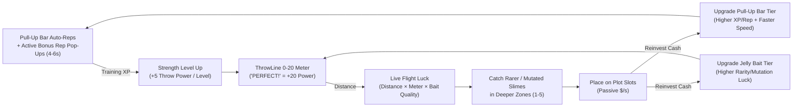

# Power System Baseline Plan — *Throw Food For Animals* (`120219252362013`)

> **Handoff Spec for Implementation**
> Reference game: [Throw Food For Animals](https://www.roblox.com/games/120219252362013/Throw-Food-For-Animals)
> Builds directly on top of the existing `PullUpMotion.luau`, `TrainingController.client.luau`, `GameConfig.luau`, `ProgressionLogic.luau`, `PlotService.luau`, `ThrowService.luau`, `ThrowController.client.luau`, and `HudController.client.luau`.

---

## 1. Reference Baseline Mechanics (*Throw Food For Animals*)

| System | Reference Game Baseline | Current Gap in This Repo |
| :--- | :--- | :--- |
| **1. Training XP → Strength Levels** | Pull-up reps grant **Training XP** toward a level bar. Each **Level Up** awards **`+5 Throw Power`**. Higher-tier pull-up bars multiply XP per rep and speed up reps. | Reps currently add flat power directly without an XP bar or Level-Up progression curve. |
| **2. Idle Auto-Reps + Active Bonus Rep Pop-Ups** | Standing on the Pull-Up Bar auto-runs reps (`~0.5s`–`1.2s`). Every **4–6 seconds**, a **Bonus Rep prompt** pops up—tapping it grants an instant bonus XP burst (`3x` XP) so active players level much faster than AFK players. | Auto-looping reps & front camera already exist in `TrainingController.client.luau`, but active **Bonus Rep pop-ups** do not exist yet. |
| **3. Distance-Scaled Live Luck** | **Throw Power** determines how far the bait flies down the lane, and **distance directly scales Luck** (`1.00x → 1.11x → 2.00x+`) in real time during flight. | Luck currently only comes from the vertical meter; distance does not scale Luck live during flight. |
| **4. 0–20 `"PERFECT!"` Throw Meter** | Stopping the oscillating vertical meter at the top (`19–20`) triggers a **`"PERFECT!"`** flash + flat **`+20` Throw Power** bonus on top of trained power, letting players clip into the next zone. | Vertical bar shows `+1..+25` without a `"PERFECT!"` callout or exact `0–20` tuning. |
| **5. Two-Axis Loop: Throw Power vs. Bait Quality** | **Throw Power** unlocks *distance/zones*, while **Food/Bait Quality** (upgraded at the Shop) multiplies *slime rarity & mutation luck* inside the zone you reach. | Only one default Jelly Bait exists; there is no Bait Quality upgrade progression yet. |

### Target Core Loop



---

## 2. File-by-File Implementation Plan

### A. Shared Config & Pure Reducers (`src/ReplicatedStorage/Shared/`)

#### 1. `src/ReplicatedStorage/Shared/GameConfig.luau`
- **Add `GameConfig.Training`**:
  - `PowerPerLevel = 5` (`+5 Throw Power` per Strength Level).
  - `GetXPRequiredForLevel(level: number): number`:
    ```luau
    function GameConfig.GetXPRequiredForLevel(level: number): number
        local lvl = math.max(1, math.floor(level))
        return math.floor(10 * (lvl ^ 1.35))
    end
    ```
    *(Example curve: Lv 1→2 = `10 XP`, Lv 5→6 = `88 XP`, Lv 10→11 = `223 XP`, Lv 20→21 = `570 XP` — tuned against our 5 Pull-Up Bar `XPPerRep` tiers `2, 8, 32, 140, 600`.)*
  - `BonusRepMultiplier = 3` (`3x` XP burst on clicking the active pop-up).
  - `BonusRepIntervalMin = 4.0`, `BonusRepIntervalMax = 6.0`, `BonusRepServerCooldown = 3.5`.
- **Tune `GameConfig.MeterSegments` (`Band 1..9`) to `0–20` + `"PERFECT!"`**:
  - Scale `BonusPower` across the 9 bands from `+1` up to **`+20`** (Band 9: `BonusPower = 20`, `IsPerfect = true`).
- **Add Live Distance Luck Formula**:
  ```luau
  function GameConfig.ComputeFlightLuck(distanceStuds: number, meterLuck: number, baitLuck: number): number
      local distMult = 1.0 + math.max(0, distanceStuds) / 350.0
      return distMult * math.max(1.0, meterLuck) * math.max(1.0, baitLuck)
  end
  ```
- **Add `GameConfig.BaitTiers` (5 Jelly Bait Quality Tiers)**:

  | Tier | Name | Cost | Luck Multiplier |
  | :--- | :--- | :--- | :--- |
  | 1 | Carrot Jelly | Free (`$0`) | `1.00x` |
  | 2 | Berry Jelly | `$150` | `1.35x` |
  | 3 | Crystal Honey | `$900` | `1.85x` |
  | 4 | Magma Tart | `$4.5K` | `2.60x` |
  | 5 | Starlight Cake | `$22.0K` | `4.00x` |

#### 2. `src/ReplicatedStorage/Shared/ProgressionLogic.luau`
- Extend `PlayerProfile` with:
  - `StrengthLevel: number` (initial `1`)
  - `TrainingXP: number` (initial `0`)
  - `BaitTier: number` (initial `1`)
- Update `ApplyPullUpRep(profile, repMultiplier?)`:
  - Computes `xpGained = math.max(1, math.floor(tierDef.XPPerRep * (repMultiplier or 1) * x2PowerBoost * trailXPMult + 0.5))`.
  - Adds `xpGained` to `profile.TrainingXP`.
  - Loops `while profile.TrainingXP >= GameConfig.GetXPRequiredForLevel(profile.StrengthLevel)` to subtract required XP, increment `profile.StrengthLevel += 1`, and add `GameConfig.Training.PowerPerLevel` (`+5`) to `profile.BaseThrowPower`.
  - Returns `{ XPGained, LevelsGained, PowerGained, NewLevel, CurrentXP, RequiredXP }`.
- Add `PurchaseBaitTier(profile): (boolean, string)`:
  - Validates next tier exists and `profile.Cash >= nextTier.Cost`, deducts cash, increments `profile.BaitTier`.
- Keep all reducers pure (zero `Workspace`/`Players` coupling) so Lune unit tests run fast and deterministically.

#### 3. `src/ReplicatedStorage/Shared/Remotes.luau`
- Add `"RequestBonusRep"` to `EVENT_NAMES`.

---

### B. Server Services (`src/ServerScriptService/`)

#### 1. `src/ServerScriptService/PlayerStateService.luau`
- Include `StrengthLevel`, `TrainingXP`, `TrainingXPRequired`, and `BaitTier` in `PlayerStateSync`.
- Handle `upgradeType == "BaitTier"` inside `RequestUpgrade.OnServerEvent`.

#### 2. `src/ServerScriptService/PlotService.luau`
- Update `TrainingRep` broadcast payload to include `XPGained`, `LevelsGained`, `PowerGained`, `StrengthLevel`, `CurrentXP`, and `RequiredXP`.
- Handle `RequestBonusRep.OnServerEvent`:
  - Verify player is actively training on their Pull-Up Bar.
  - Enforce server-side `3.5s` cooldown per player.
  - Call `ProgressionLogic.ApplyPullUpRep(profile, GameConfig.Training.BonusRepMultiplier)`, sync state, and fire `TrainingRep` with `IsBonus = true`.

#### 3. `src/ServerScriptService/ThrowService.luau`
- Read `baitDef = GameConfig.BaitTiers[profile.BaitTier] or GameConfig.BaitTiers[1]`.
- Compute authoritative `totalLuck = GameConfig.ComputeFlightLuck(simResult.Distance, meterSeg.LuckMultiplier, baitDef.LuckMultiplier)`.
- Pass `totalLuck` into `ProgressionLogic.EvaluateThrowReward(...)`.
- Include `IsPerfect = meterSeg.IsPerfect`, `MeterLuck = meterSeg.LuckMultiplier`, `BaitLuck = baitDef.LuckMultiplier`, `BaitTier = profile.BaitTier`, and `LuckMultiplier = totalLuck` in `ThrowBroadcast`.

---

### C. Client Controllers (`src/StarterPlayer/StarterPlayerScripts/`)

#### 1. `src/StarterPlayer/StarterPlayerScripts/TrainingController.client.luau`
- **Training XP Progress Bar (shown while mounted on the Pull-Up Bar)**:
  - Displays `Lv. X`, smooth tweened XP fill bar (`CurrentXP / RequiredXP`), and `Next: +5 Power`.
  - On `LevelsGained > 0`, flash a celebratory **`LEVEL UP! +5 POWER`** popup + extra camera punch.
- **Active Bonus Rep Pop-Ups (every 4–6 seconds while training)**:
  - Schedule a bouncy clickable **`⚡ BONUS REP! (3x XP)`** bevel button (`UiKit.CreateBevelButton`) at a safe random screen offset (avoiding HUD edges).
  - Auto-expires after `2.5s` if missed.
  - Clicking it fires `RequestBonusRep:FireServer()`, plays a pop animation, and spawns a floating `+3x XP!` text burst.

#### 2. `src/StarterPlayer/StarterPlayerScripts/ThrowController.client.luau`
- **`"PERFECT! +20"` Callout**:
  - When locking Band 9 (`IsPerfect == true`), display a bold golden **`PERFECT! +20`** pop label above the throw bar.
- **Live Distance-Scaled Luck Ticker**:
  - During mid-air flight, recalculate `GameConfig.ComputeFlightLuck(math.max(0, pos.Z), payload.MeterLuck, payload.BaitLuck)` every frame so the top-center **`1.XXx LUCK`** counter smoothly climbs as the bait flies further down the lane.

#### 3. `src/StarterPlayer/StarterPlayerScripts/HudController.client.luau`
- Add a **Jelly Bait Quality** upgrade button inside the **Shop** modal (`Carrot Jelly` → `Berry Jelly` → `Crystal Honey` → `Magma Tart` → `Starlight Cake`, displaying current Luck multiplier and next tier cost).

---

### D. Unit Tests & Docs Regeneration

#### 1. `tests/ProgressionLogic.spec.luau`
Add unit tests covering:
- `ApplyPullUpRep` XP accumulation, exact level-up thresholds, multi-level rollovers, and `+5 Throw Power` per `StrengthLevel`.
- `3x` Bonus Rep XP multiplier scaling.
- `PurchaseBaitTier` affordability checks, cash deduction, and max-tier guard.
- `GameConfig.ComputeFlightLuck` monotonic scaling with distance, meter luck, and bait quality.
- `GameConfig.EvaluateMeterRatio(1.0)` returning `IsPerfect = true` and `BonusPower = 20`.

#### 2. Regenerate Data Reference
- Run `lune run scripts/gen-docs-data` to update `docs/DATA-REFERENCE.md` (and `docs/docs/DATA-REFERENCE.md` if mirrored) with the new `BaitTiers`, `Training` curve, and `0–20` `MeterSegments`.

---

## 3. Verification Checklist

1. `lune run tests/run-tests` — all suites (`ThrowPhysics`, `ProgressionLogic`, `PullUpMotion`) pass with `0` failures.
2. `lune run scripts/gen-docs-data` — regenerates data docs cleanly.
3. `rojo sourcemap default.project.json --output sourcemap.json` & `rojo build default.project.json -o verify-build.rbxl` — `0` errors.
4. **In Roblox Studio (`Play` / `F5`)**:
   - Mount Pull-Up Bar → verify Training XP bar fills on auto-reps, triggers **`LEVEL UP! +5 POWER`**, and spawns clickable **`⚡ BONUS REP! (3x XP)`** pop-ups every 4–6s.
   - Throw from `ThrowLine` at Band 9 → verify **`PERFECT! +20`** flashes and **`1.XXx LUCK`** ticks upward live as the bait flies further down the lane.
   - Upgrade Jelly Bait in Shop → verify higher Luck multiplier applies on the next throw.
